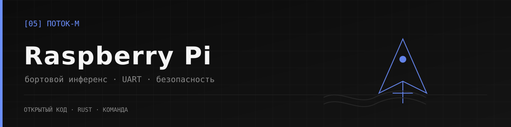

# potok-m-edge

Бортовой инференс на Raspberry Pi 4 B: приём запроса от STM32, запуск модели, отдача поправки и диагностики.

## Граница

Raspberry Pi — советчик. STM32 владеет фазами полёта, ПИД, интерлоками и сервами. На двигателе ИИ выключен; три пропуска или `ai_healthy = 0` отключают ассистента до конца полёта.

## Что внутри

- `src/` — Rust-рантайм модели, канонический читатель v2/v3 export, stateful step/warmup/reset.
- `src/speculative.rs` — вызов лёгкой модели каждый кадр и тяжёлой модели по требованию.
- `src/lowlat.rs` — профиль UART 42/16 байт на 2 Мбит/с.
- `src/calibration.rs` — temperature/isotonic калибровка confidence.
- `tests/` — побайтовая сверка с Python, safety-тесты, замеры hot path.

## Контракт

Вход: 14 физических признаков + 6 conditioning в м/с². Выход: две поправки, confidence, `ai_healthy`. Порог берётся из `calibration.json`, не из константы. Файл модели в репозиторий не попадает: бинарный export приходит из `potok-m-ai` при деплое и загружается в RAM.

## Запуск

```sh
cargo fmt --all -- --check
cargo clippy --all-targets
cargo test --release --all-targets
```

systemd-юнит закреплён на отдельном ядре с SCHED_FIFO и `CAP_SYS_NICE`.

## Статус

Хост-тесты зелёные; замер p99 на реальном Pi пока не проведён. Модель не прошла лётную квалификацию до положительного closed-loop A/B.

## Репозитории

[potok-m-ai] · [potok-m-protocol] · [potok-m-sim] · [potok-m-firmware] · [potok-m]

Лицензия: MIT.
